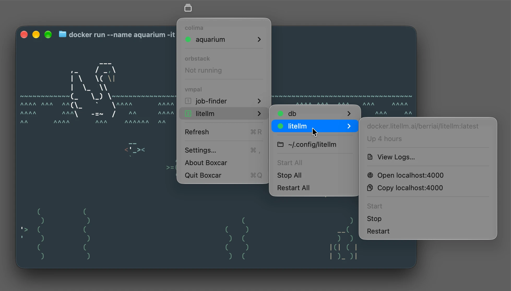

# Boxcar

**Boxcar** is a small Mac-native menu bar app that shows you the current status of your Docker containers and lets you stop and start them and tail their logs.

Boxcar works with any Docker runtime. It’s especially useful alongside [Docker Desktop](https://www.docker.com/products/docker-desktop/), which does not show running containers in its menu bar icon, or with alternative runtimes like [Colima](https://colima.run) and [VMPal](https://vmpal.com) that don’t have a menu bar widget.



## Install

Download [the latest release](https://github.com/natesilva/boxcar/releases/latest), or use Homebrew:

```shell
brew install --cask natesilva/tap/boxcar
```

## It’s not fancy

Boxcar is inspired by Classic Mac OS desk accessories. It’s meant to be small, simple, and useful. It’s _utilitarian_.

## It’s useful

Containers can be started and stopped, you can tail the logs on any of your containers, and you can open a web site if a container exposes one.

Docker Compose stacks are grouped together.

Boxcar recognizes installed Docker contexts, so if you have more than one Docker environment installed (say, [Colima](https://colima.run), [OrbStack](https://orbstack.dev/) and [VMPal](https://vmpal.com)), you can see all of them and which containers are running under which environment.

## Yep, AI

Boxcar was written by Claude, under my supervision (an experienced programmer). In part it’s meant to show that high-quality, non-slop, Mac apps are totally viable. Making a good app with Claude’s help still requires both programming knowledge and an understanding of Mac standards and conventions.

I don’t usually write Mac apps, but I’m a longtime—and picky—Mac user. That’s why this approach worked for me.

👋🏼 This `README.md` is written entirely by me, Nate, including the em-dashes.

## Version 1

This app will probably work for you, but it’s hard for me to test every Docker runtime. macOS doesn’t support nested virtualization for macOS guests, so every Docker runtime has to be installed on my real Mac for testing.

The minimum supported macOS version is macOS 15 Sequoia.

If something doesn’t work, open an issue here on GitHub.

## License

This app is free, and MIT-licensed.
